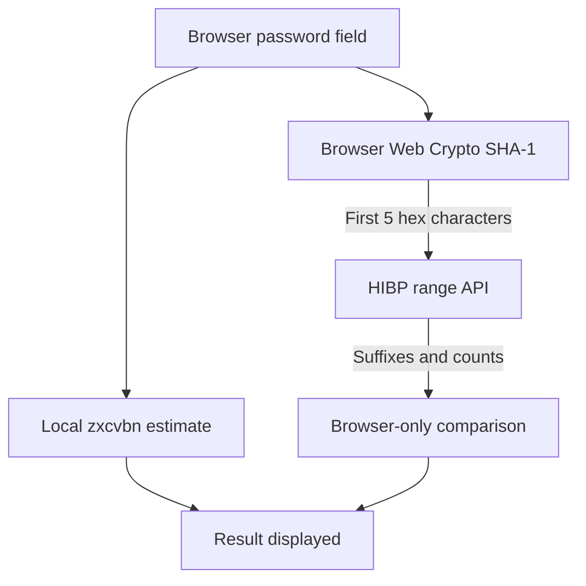

# Password Analyzer — browser-side strength and breach screening

A small local web app that estimates password guessability with [zxcvbn](https://github.com/dropbox/zxcvbn) and checks the free [Have I Been Pwned Pwned Passwords API](https://haveibeenpwned.com/API/v3#PwnedPasswords). Strength analysis, SHA-1 hashing, and returned-hash comparison all run **in your browser**. Flask only serves local HTML, JavaScript, and CSS; it has no password-processing endpoint.

## Run and test

Requires Python 3.10+ for Flask and a browser with Web Crypto support:

```bash
python -m venv .venv
# macOS/Linux: source .venv/bin/activate
# Windows PowerShell: .venv\Scripts\Activate.ps1
python -m pip install -r requirements.txt
python app.py
```

Open http://127.0.0.1:5000. Use a disposable test phrase and click **Analyze password**. Typing alone makes no API request. The remote lookup needs network access; if it fails, the result says **unavailable**, never “not found.” Tests require Python and Node.js, but no external network:

```bash
python -m unittest discover -s tests -v
node --test tests/test_browser.cjs
```

## Data flow and privacy boundary



The **plaintext password and complete hash do not go to Flask or HIBP**. The browser sends a five-character SHA-1 prefix directly to HIBP only after you submit. The input is cleared after analysis. No password, full hash, or API response is stored in browser storage or on the Flask server. A trusted local copy still matters: altered JavaScript, malicious browser extensions, or a compromised machine can read the password field. The external HIBP service sees the prefix and network metadata; a prefix is not a cryptographic guarantee of perfect anonymity.

SHA-1 is used **only because it is part of the HIBP lookup protocol**. It is not a password-storage algorithm here. The range request uses `Add-Padding: true` to reduce response-size information leakage; padded rows with count zero are ignored. A positive count means that exact password hash appears that many times in the Pwned Passwords corpus, not that many distinct sites or breaches. A no-match answer does not prove a password is safe. zxcvbn's displayed guessing-time estimate assumes a specific offline slow-hash scenario, not a universal cracking time.

## Implementation

- `static/vendor/zxcvbn.js` is a locally bundled version 4.4.2 of the MIT-licensed zxcvbn library. Its license is alongside it. No remote script is loaded.
- `static/password-check.js` uses browser Web Crypto to calculate SHA-1, requests only the five-character hash prefix, validates returned suffix/count rows, and distinguishes `found`, `not_found`, and `unavailable`.
- `static/app.js` submits only after an explicit click, uses `textContent` for feedback, and clears the password field. The browser makes no request to Flask containing a password.
- `app.py` binds localhost with debug mode off and serves only assets. It sets no-store, no-referrer, frame, MIME, and Content Security Policy headers.
- `tests/test_browser.cjs` mocks HIBP responses and verifies that only a prefix goes into the request. `tests/test_server.py` verifies there is no password endpoint.

This is an educational evaluator, not an account system or a guarantee of safety. The live HIBP path has not been verified in this environment; the test suite mocks it. A browser-only architecture removes plaintext from our server, but the integrity of delivered JavaScript is now especially important. Future work: a reproducible asset build with integrity verification, browser UI automation, accessibility testing, and an optional offline blocklist for no-network demonstrations.

See [interview notes](docs/interview.md) for a short explanation and likely technical questions.
